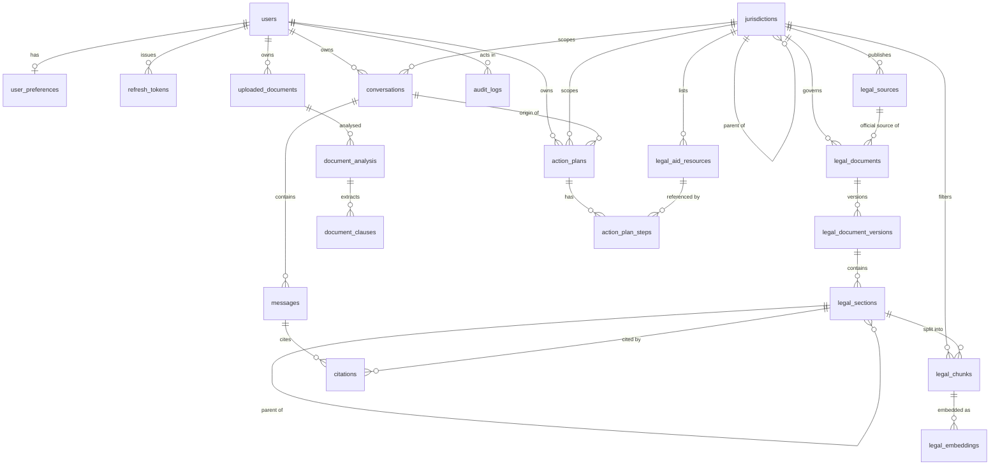

# Backend Architecture

Status key: **[built]** implemented and tested, **[schema]** tables exist, logic not yet built, **[planned]** design only.

## 0. Findings from the frontend inspection

`../frontend` is a fresh Next.js 16 / React 19 scaffold (shadcn `button`, one landing `page.tsx`, zustand, framer-motion, gsap, lenis). It contains **no service layer, API client, types or fetch calls**. There are therefore no existing contracts to align with. The contracts in section 3 are the proposal; the backend's generated OpenAPI (`/openapi.json`, non-production) becomes the source for frontend types.

## 1. Architecture

One deployable FastAPI service (modular monolith, no microservices), PostgreSQL + pgvector, optional Redis.

```
Next.js ──HTTPS──▶ API gateway layer (app/middleware, app/api)
                    request-id · size limit · CORS · rate limit · auth · error envelope
                       │
        ┌──────────────┼───────────────────────────────┐
        ▼              ▼                               ▼
   services/*     rag/*  (retrieval, citations)    document_intelligence/*
   (use cases)         │                               │
        │              ▼                               ▼
        │        ai/services/inference ◀──── ai/providers/base ◀── nvidia_glm
        ▼
   repositories/* ──▶ SQLAlchemy async ──▶ PostgreSQL (+pgvector, tsvector)
```

Layering rule: `api → services → (repositories, rag, ai, document_intelligence, action_engine)`. Endpoints hold no business logic. Only `ai/providers/*` knows about NVIDIA; everything else depends on `ai/providers/base.LLMProvider`.

### Grounded-answer flow (chat)

1. Resolve jurisdiction (explicit request value → conversation → user preference). If none, or coverage is `none`, return `evidence_status = unsupported_jurisdiction` **without calling the model**.
2. Hybrid retrieval, filtered to that jurisdiction and `is_current` versions: pgvector cosine top-k + tsvector top-k, merged with reciprocal-rank fusion.
3. If evidence is below a relevance floor, return `insufficient` without calling the model.
4. Prompt = system rules + numbered evidence blocks (each with an opaque `source_id`) + question. The user question and evidence are delimited as data; instructions inside them are ignored.
5. Model returns JSON. `response_validator` checks the schema.
6. **Citation verification** (code, not model): every cited `source_id` must be in the retrieved set; the section must exist in that version; the jurisdiction must match; the URL is **rewritten from the stored record**, never taken from model output. Unsupported claims (key points without a surviving citation) are dropped or flagged; if nothing survives, status becomes `insufficient`.
7. Persist message + citations with their verification status.

Model confidence is never used as a signal of correctness.

## 2. Database ER diagram

All PKs are UUID. 20 tables (the 19 requested plus `refresh_tokens`). Rights explorer tables (`rights_categories`, `rights_topics`) are added with the rights endpoints in Phase 3 because the requested list has nothing to back `/rights/*`.



Key integrity rules (enforced in the DB, see `app/models/`):

- `jurisdictions`: unique `(country_code, subdivision_code)` with NULLs not distinct; a subdivision must have a parent and a country must not.
- `legal_document_versions`: one current version per document (partial unique index); `effective_to >= effective_from`.
- `legal_chunks.tsv`: generated `tsvector` (`simple` config, multilingual-safe) with a GIN index. `legal_embeddings.embedding`: `vector(EMBEDDING_DIM)` with an HNSW cosine index; unique per `(chunk_id, model)`.
- Enumerations are `VARCHAR` + `CHECK` (not PG enums) so adding a value is a simple migration.
- `citations.section_id` is nullable so a hallucinated citation can be recorded with `verification_status = not_found` for audit.
- `document_analysis`: `kind = comparison` iff `compared_with_id` is set.
- `audit_logs`: append-only by convention; stores ids and metadata, never content.
- User deletion cascades to conversations, uploads, plans and tokens; audit rows keep the event with `user_id` set to NULL.

## 3. API contract (all under `/api/v1`)

Errors always use one envelope, with `request_id` also in the `X-Request-ID` header:

```json
{"error": {"code": "validation_error", "message": "...", "details": [{"loc": ["body","email"], "message": "...", "type": "..."}], "request_id": "..."}}
```

Codes: `bad_request` 400 · `unauthorized` 401 · `forbidden` 403 · `not_found` 404 · `conflict` 409 · `payload_too_large` 413 · `validation_error` 422 · `unsupported_jurisdiction` 422 · `rate_limited` 429 (+`Retry-After`) · `upstream_unavailable` 503 · `internal_error` 500.

| Area | Endpoint | Auth | Phase |
|---|---|---|---|
| Health | `GET /health` | none | 1 **[built]** |
| Auth | `POST /auth/register`, `/auth/login`, `/auth/refresh`, `/auth/logout`; `GET /auth/me` | none / bearer | 4 |
| Chat | `POST /chat`, `POST /chat/stream` (SSE) | bearer | 3 |
| Conversations | `GET /conversations`, `GET/DELETE /conversations/{id}` | bearer, owner only | 3 |
| Rights | `GET /rights/categories`, `/rights/topics`, `/rights/topics/{id}`, `/rights/search` | optional | 3 |
| Sources | `GET /sources`, `/sources/{id}`, `/sources/{id}/sections`, `/sources/search` | optional | 2–3 |
| Action plans | `POST /action-plans/generate`, `GET /action-plans`, `GET /action-plans/{id}`, `PATCH /action-plans/{id}/steps/{step_id}` | bearer, owner only | 3 |
| Jurisdictions | `GET /jurisdictions/countries`, `/{country_code}`, `/{country_code}/subdivisions` | none | 3 |
| Documents | `POST /documents/upload`, `GET/DELETE /documents/{id}`, `POST /documents/{id}/analyze`, `GET /documents/{id}/analysis`, `POST /documents/compare` | bearer, owner only | 3 |

Chat request: `{message, conversation_id?, jurisdiction: {country, subdivision?}, language?}`. Chat response is the legal response in section 4 plus `conversation_id`, `message_id`. `/chat/stream` emits SSE events `token` (text deltas, unverified), then one `final` event carrying the verified structured response; the client must render `final` as authoritative.

Document analysis responses always include `disclaimer` ("Preliminary AI assessment, not legal advice or a legal judgment") and per-clause `risk_level` of `none|low|medium|high`.

Authenticated list endpoints use `limit`/`offset` and return `{items, total, limit, offset}`.

## 4. Legal response contract

```
answer: str                       key_points: [str]
jurisdiction: {country, subdivision|null}
applicable_laws: [{document_name, official_identifier|null}]
citations: [{source_id, document_name, section, source_url, verification_status}]
next_steps: [str]                 warnings: [str]        limitations: [str]
evidence_status: sufficient | partial | insufficient | unsupported_jurisdiction
```

`verification_status`: `verified | unverified | mismatched_jurisdiction | not_found | url_mismatch`. Only `verified` citations are shown to users as sources. `source_url`, `document_name`, `section` always come from stored records.

## 5. Security architecture

| Concern | Design |
|---|---|
| Authn | Argon2id password hashes; short-lived JWT access token; opaque rotating refresh token stored server-side as SHA-256 hash with a family id (reuse of a rotated token revokes the family). |
| Authz | Every user-owned resource query filters by `user_id`; other users' ids return 404, not 403. Admin-only ingestion routes check `role`. |
| Secrets | Env only (`pydantic-settings`, `SecretStr`). Production start fails on a short `JWT_SECRET` or wildcard CORS. NVIDIA key never leaves the server. |
| Transport/browser | CORS allow-list, no wildcard with credentials; `nosniff`, `X-Frame-Options: DENY`, `no-store`; docs disabled in production. |
| Abuse | Per-IP/per-user rate limit (Redis, in-memory fallback), stricter on auth and uploads; body size limit (global and upload) enforced both on `Content-Length` and while streaming. |
| Injection | SQLAlchemy bound parameters only; no string-built SQL. Prompt injection: untrusted text (user question, uploaded documents, retrieved text) is wrapped in delimiters and labelled as data; model output is schema-validated and citations are re-derived in code, so injected instructions cannot add sources or URLs. |
| Uploads | Allow-list by extension **and** magic bytes (PDF, DOCX); server-generated storage key, original name kept as metadata only; DOCX zip-bomb and PDF page/size caps; parsing in a worker thread with timeouts; files stored outside the web root; sha256 recorded. |
| Privacy | Logs: path/status/timing only, key-based and pattern-based redaction (emails, bearer tokens, long numbers); no message or document text in logs or audit rows. `store_history=false` skips persistence; per-user retention; `DELETE` endpoints hard-delete rows and stored files; scheduled purge of expired uploads/conversations. |
| Audit | `audit_logs` for login, failed login, token reuse, upload, analyze, delete, ingestion; IP stored as a salted hash. |
| Supply chain | Pinned minimum versions; `pip-audit` in CI (planned). |

## 6. Folder structure

As requested; see the tree under `app/`. Notable additions: `docs/`, `requirements-dev.txt`, `pytest.ini`, `alembic.ini`.

## 7. Phase plan and honesty ledger

| Phase | Scope | State |
|---|---|---|
| 1 | Architecture, FastAPI foundation, config, DB models, migration, `/health`, middleware, error envelope, logging redaction | **built**; migration SQL verified on PostgreSQL 16 *except* the pgvector pieces (see README "Known gaps") |
| 2 | NVIDIA provider, ingestion, retrieval, citation verification | planned |
| 3 | Chat, rights, jurisdictions, documents, action plans | planned |
| 4 | Auth hardening, rate limiting, security tests, deployment | planned |
